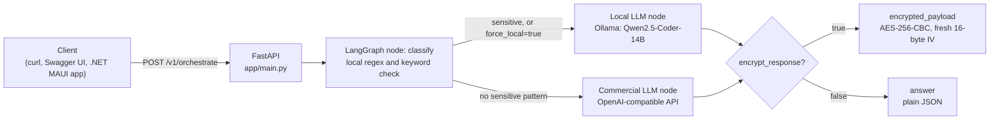

# Hybrid LLM Orchestrator (FastAPI + LangGraph)

A privacy-first Python backend that decides **before any network call** where a prompt may go: prompts that contain personal, clinical/scheduling or credential data stay on a **local LLM served by Ollama**, and everything else is sent to a **commercial cloud LLM** through an OpenAI-compatible API. The answer can optionally be returned **AES-256-CBC encrypted**, with a fresh random IV for every response.

> **Scope:** a standalone public re-implementation of the backend routing and encryption design of my local-first AI scheduling system (C# .NET MAUI client + Python backend). The desktop client and real data are not included.

## Architecture



## Routing Examples

Each row is covered by a unit test:

| Prompt | `force_local` | Route | Matched rule |
| :--- | :---: | :--- | :--- |
| 患者のカルテと明日の予約枠を確認してください | `false` | `local_llm` | Japanese clinical/scheduling terms (患者, カルテ, 予約枠) |
| Please pull the patient's medical record. | `false` | `local_llm` | English medical terms (patient, medical record) |
| 連絡先は090-1234-5678です。 | `false` | `local_llm` | phone-number pattern |
| Explain Big O notation for hash map lookups. | `false` | `commercial_llm` | no sensitive pattern |
| Summarize Python list comprehensions. | `true` | `local_llm` | caller forced local execution |

## Key Design Decisions

- **Deterministic privacy guardrail before inference:** asking a cloud LLM whether a prompt is confidential would already send the prompt outside. The LangGraph entry node (`classify_request_node`) therefore checks the prompt locally with regular expressions and Japanese/English keyword lists before any outbound call can happen.
- **Fail-closed defaults:** mock mode stays on unless `MOCK_LLM_RESPONSES` is explicitly set to `false` (or `0` / `no`). Encryption refuses to run without `AES_SHARED_SECRET` (there is no built-in fallback key), and that check happens before the LLM is called. When encryption is requested, the plaintext `answer` is never returned. Upstream error details are logged on the server instead of being returned to the client.
- **Fresh IV for every response:** each encrypted answer uses a new 16-byte random IV from `os.urandom`, so identical answers never produce identical ciphertexts.
- **Separation of concerns:** routing and state (`app/graph.py`), API contracts (`app/schemas.py`), encryption (`app/crypto.py`) and HTTP transport (`app/main.py`) live in separate modules and are tested separately.
- **Zero-cost verification:** in the default mock mode, reviewers can run the tests and the API without a GPU, Ollama or a paid API key.

## Quick Start

Requires Python 3.10+.

### 1. Install

```bash
python -m venv .venv
source .venv/bin/activate          # Windows PowerShell: .venv\Scripts\Activate.ps1
pip install -r requirements.txt
```

### 2. Run the tests (no GPU, Ollama or API key needed)

```bash
python -m unittest discover -s tests -v
```

### 3. Start the API (mock mode is on by default)

```bash
uvicorn app.main:app --reload --port 8000
```

Then open <http://localhost:8000/docs> to try both endpoints in the browser (Swagger UI).

### 4. Call it with curl (macOS / Linux / Git Bash)

Sensitive prompt, routed to the local LLM:

```bash
curl -X POST http://localhost:8000/v1/orchestrate \
  -H "Content-Type: application/json" \
  -d '{"prompt": "患者のカルテと明日の予約枠を確認してください"}'
```

Response in mock mode (without `latency_ms`, the processing time, which varies):

```json
{
  "route": "local_llm",
  "model_used": "qwen2.5-coder:14b",
  "routing_reason": "Sensitive/PII pattern detected -> kept on the local LLM.",
  "pii_detected": true,
  "answer": "[MOCK LOCAL:qwen2.5-coder:14b] Processed on-premises; no external network call was made.",
  "encrypted_payload": null
}
```

General prompt, routed to the commercial LLM:

```bash
curl -X POST http://localhost:8000/v1/orchestrate \
  -H "Content-Type: application/json" \
  -d '{"prompt": "Explain Big O notation for hash map lookups."}'
```

To get an encrypted answer, set `AES_SHARED_SECRET` (see Configuration) and add `"encrypt_response": true` to the request. The response then carries `encrypted_payload` (`ciphertext_b64`, `iv_b64`) and `answer` is `null`. `decrypt_aes256_cbc` in `app/crypto.py` shows the matching decryption step.

## Configuration

All settings are environment variables; `.env.example` lists them with their defaults. To use a file, copy it to `.env`, fill it in and start the server with `uvicorn app.main:app --env-file .env`.

| Variable | Default | Purpose |
| :--- | :--- | :--- |
| `MOCK_LLM_RESPONSES` | `true` | Return mock answers instead of calling an LLM. Only `false`, `0` or `no` turns it off. |
| `OLLAMA_BASE_URL` | `http://localhost:11434` | Local Ollama server |
| `LOCAL_LLM_MODEL` | `qwen2.5-coder:14b` | Ollama model for sensitive prompts |
| `COMMERCIAL_LLM_BASE_URL` | `https://api.openai.com/v1` | Any OpenAI-compatible endpoint |
| `COMMERCIAL_LLM_MODEL` | `gpt-4o-mini` | Model name sent to that endpoint |
| `COMMERCIAL_LLM_API_KEY` | (empty) | Needed only when mock mode is off |
| `AES_SHARED_SECRET` | (empty) | Needed only for `"encrypt_response": true`; the AES-256 key is its SHA-256 digest |

## Tests

`tests/test_orchestrator.py` holds 11 tests written with the standard-library `unittest`:

- **Routing:** the five examples above, plus a check that mock mode makes no network calls.
- **Graph wiring:** the compiled LangGraph graph runs `classify` first and branches to `local_llm` or `commercial_llm`.
- **Encryption:** a round trip with a fresh IV each time, and a refusal when no secret is configured.
- **API:** an encrypted response never contains the plaintext answer, and an encryption request without a secret is rejected before any LLM call.

If the packages are not installed yet, the routing tests still run (a small sequential fallback stands in for LangGraph), and tests whose packages are missing are skipped.

## Limitations

- **Rule-based PII screening:** regular expressions and keyword lists are fast and predictable, but they miss sensitive data that matches no rule (for example, a bare personal name). A production setup would add a local NER model (such as Microsoft Presidio, or GiNZA for Japanese) as a second layer.
- **CBC is not authenticated:** AES-256-CBC protects confidentiality but not integrity. It is kept for compatibility with the AES-256-CBC (PKCS7) scheme of the original .NET MAUI client; AES-GCM, or CBC with an HMAC-SHA256 tag (encrypt-then-MAC), would be the better default.
- **Demo key handling:** the key is the SHA-256 digest of a shared secret read from an environment variable. Production should use a random 32-byte key from a secret manager or KMS, with rotation.
- **Only the response is encrypted, and the API has no authentication:** requests travel as plain JSON. Run the service behind TLS or a private network, and add authentication before exposing it.
- **Mock answers:** in the default mode the answers are fixed strings that only show which route was taken.

## Project Structure

```text
hybrid-llm-orchestrator/
├── README.md
├── requirements.txt
├── .env.example              # environment variables and their defaults (no secrets)
├── .gitignore
├── app/
│   ├── __init__.py
│   ├── main.py               # FastAPI endpoints: GET /health, POST /v1/orchestrate
│   ├── graph.py              # LangGraph StateGraph: privacy check, then conditional routing
│   ├── crypto.py             # AES-256-CBC encryption/decryption with a fresh IV per message
│   └── schemas.py            # Pydantic v2 request/response models
└── tests/
    └── test_orchestrator.py  # 11 unit tests (routing, graph wiring, encryption, API)
```

## 日本語サマリ（ポートフォリオ概要）

本リポジトリは、C# (.NET MAUI) クライアントと Python バックエンドで構成したローカルファーストの AI スケジュール管理システムのうち、**バックエンドの振り分け制御と応答の暗号化**の設計を、公開用に単体で作り直したものです。

- **推論前の決定論的プライバシーガードレール (`app/graph.py`)**: 機密かどうかの判定を外部 LLM に任せると、その時点でデータが外部に送信されてしまいます。そこで LangGraph の入口ノードで、個人情報・医療/予約関連の語・認証情報をローカルの正規表現とキーワードで判定し、該当すればローカル LLM（Ollama / Qwen2.5-Coder-14B）だけで処理します。
- **安全側に倒す初期設定**: モックモードは明示的に `false`（または `0` / `no`）にしない限りオンです。暗号化は鍵（`AES_SHARED_SECRET`）が未設定なら LLM を呼ぶ前に拒否し、暗号化を求められたときは平文を返しません。
- **応答ごとに新しい IV (`app/crypto.py`)**: 暗号化のたびに 16 バイトの乱数 IV を `os.urandom` で生成し、同じ平文から同じ暗号文が出ないようにしています。
- **責務の分離とテスト**: API 層・振り分け層・暗号化層・スキーマ層を分け、11 件のユニットテストで振り分け・グラフ構成・暗号化・API の動作を確認しています（GPU・API キー不要）。

## Author

Shunsuke H. — Trilingual (EN / JP / CN) Systems & AI Builder focusing on local-first LLM infrastructure, Python orchestration pipelines, and security-conscious engineering.
